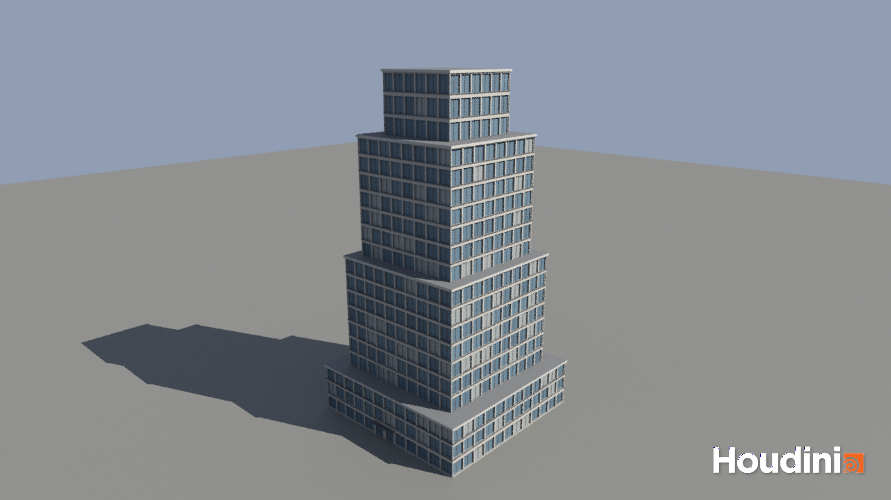
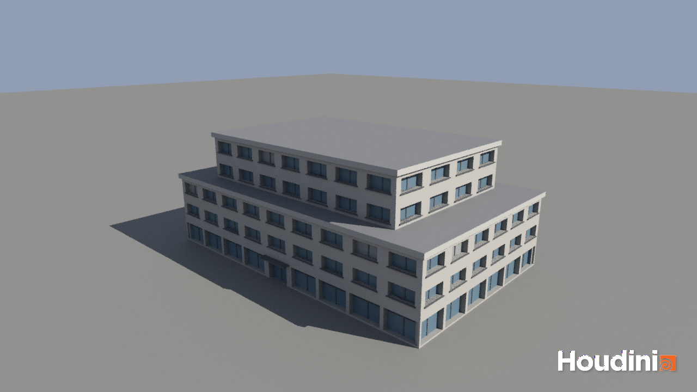

# CIS 5660 Lab 06 Procedural Buildings

## My Building: Procedural Office Tower

Everything lives in one HDA, `tonytg::building`, which is **embedded in `lab6.hipnc`** (Asset Manager → Embedded), so the HIP file opens on its own. The asset stacks a set of resizable blocks, then uses a small shape grammar to split every wall into floors and bays and place a window module in each cell.

### How it works

1. **Expandable blocks.** A For-Each loop in feedback mode builds one box per entry in the *Floors* multiparm (`x_#`, `y_#`, `z_#`). A Match Size SOP sits each new box on top of the previous one.
2. **Label faces.** `label_faces` puts every face into a `wall`, `roof` or `base` group based on its normal.
3. **Split the facade.** `facade_cells` measures each wall and splits it into `rint(height / Floor Height)` floors × `rint(width / Bay Width)` bays. Those cell sizes are then stretched slightly so the grid fits the wall exactly. Each cell becomes a point with `N`, `up` and `scale` attributes, plus row/column information.
4. **Grammar rules.** `facade_rules` and `entrance_rule` pick a module for every cell:
   - a wall too narrow for a window → `wall` (blank panel)
   - the ground floor → `storefront` (tall glazing)
   - the middle bay of the widest ground-floor wall → `door`, or two doors if the wall has an even number of bays
   - everything else → `window`
5. **Placing assets.** The `facade_modules` subnet models each module as a 1×1 tile facing +Z. The window has a flat wall panel, a recessed glass pane, a centre mullion and a sill. `place_modules` (Copy to Points) copies the module whose `name` matches each cell point, then orients and scales it to fit the cell.
6. **Extra components and colour.** Every block gets a thin overhanging ledge slab on its roof (`ledge_lip`, `ledge_slab`). The geometry is coloured by part (concrete, glass, dark frames, roofing). Each window's glass gets a random tint, so some read as having blinds down.

### Parameters (Facade tab)

| Parameter | What it does |
| --- | --- |
| Floor Height / Bay Width | Target size of a facade cell. Changing these re-grids every wall. |
| Window Width / Height / Recess | Size of the window opening (as a fraction of the cell) and how deep the glass sits. |
| Ground Floor Storefront, Entrance Door | Turn the ground-floor rules on or off. |
| Ledge Height | Thickness of the roof ledge on each block (0 turns it off). |
| Glass Variation, Seed | How much the glass tint varies from window to window, and the random seed. |

### Ground floor

Storefront glazing runs along the street level, with the entrance and its canopy in the middle of the widest wall.

### Variations

The same HDA with different block sizes and facade parameters:

| Stepped glass tower | Low-rise office |
| --- | --- |
|  |  |

Renders are Karma CPU from `/out/karma_render` through `/obj/render_cam`, with a sun light, a sky light and a ground plane. The watermark comes from the Apprentice license.

---

## Project Overview
In this lab, you will follow a Houdini tutorial on using shape grammars to make procedural buildings. The tutorial is linked here: 
https://www.youtube.com/watch?v=uIe97023sDk&t=979s&ab_channel=SimonHoudini 

### Setup
The tutorial requires some nodes from `SideFX Labs`. If you haven’t already installed the Labs packages, you can do so at the “Labs/Packages” tab of the Houdini Launcher.
Make sure that the version of `Labs` that you install is __not__ newer than your overall Houdini install (e.g. if you have Houdini 21.544,
don't install `Labs` 22.650). Use the Production version of `Labs`, not the Daily.

### Base Project
Follow the tutorial up through the Placing Assets section (ending at about 27 minutes). Create a simple office-style building with procedurally-placed windows.

### Advanced Project
Choose any of the tutorial segments *after* the 27-minute mark. Implement at least one of them to make your building more interesting.

### Extra Credit
Give your building color/textures/additional components!

## Submission
- Update your README with screenshots or renders of your building.
- Create a pull request to this repository
- Submit your Houdini file to Canvas along with a link to your pull request 
- IMPORTANT NOTE: make sure your HDA is either embedded in the HIP file or included with your submission. Creating an HDA saves a .hda file at the location you specify with the definition of your HDA. 
Alternatively, when you save your HDA you can choose the “Embedded in HIP File” option (rather than specifying the path), and the hda definition will be automatically embedded in your hip file (and no additional files will be needed with submission).
